<h1 align="center">Umi-OCR PP-OCRv6 优化版</h1>

<p align="center">
  <strong>基于 Umi-OCR v2.1.5 的离线 OCR 便携版 · SimdPaddleOCR 引擎 · 暖色无边框界面重设计</strong>
</p>

<p align="center">
  <a href="LICENSE"></a>
  <a href="#下载与运行"></a>
  
</p>

---

## 这是什么

本项目是 [Umi-OCR](https://github.com/hiroi-sora/Umi-OCR) v2.1.5 的一个**社区优化修改版**，在保留原版全部功能的基础上做了两件事：

1. **更换 OCR 引擎为 [SimdPaddleOCR](https://github.com/sdcb/SimdPaddleOCR) 并设为默认** —— 纯托管（C#）PP-OCRv6 推理库，不依赖 OpenCV / OpenVINO / Paddle Inference 等原生组件，OCR 在独立的 .NET 进程中运行，彻底告别原生 DLL 冲突问题。
2. **对图形界面做了暖色主题与无边框窗口的重新设计** —— 去掉系统标题栏、顶部右侧集成窗口控制按钮、以左侧导航栏取代标签页、统一暖黄色调，整体更接近现代原生桌面应用的观感。

**免费、开源、完全离线**。完整可运行程序以 Releases 的 `.7z` 便携包形式分发，解压即用，无需联网、无需安装、无需 Python 环境。

> 💙 特别感谢 **[SimdPaddleOCR](https://github.com/sdcb/SimdPaddleOCR)**（作者 [sdcb](https://github.com/sdcb)）提供的高质量纯托管 PP-OCRv6 推理引擎，本项目的 OCR 能力完全建立在这套优秀的开源库之上。

> 本仓库为**源码与文档**仓库（轻量）；完整可运行的程序随 Releases 的 `.7z` 包分发，解压后双击 `Umi-OCR.exe` 即用，无需任何构建步骤。

---

## ✨ 界面预览

全新暖色无边框界面 —— 实际运行效果：

<p align="center">
  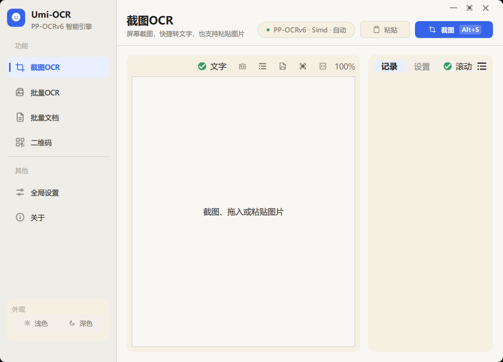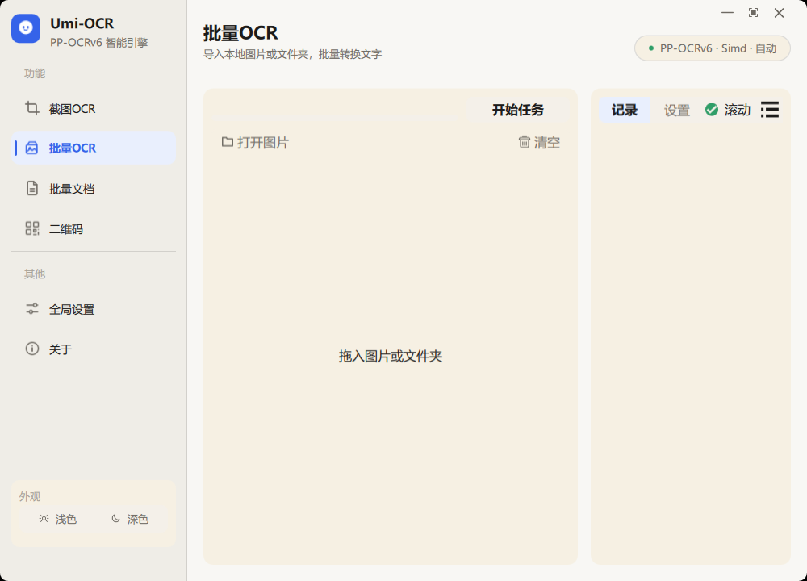
  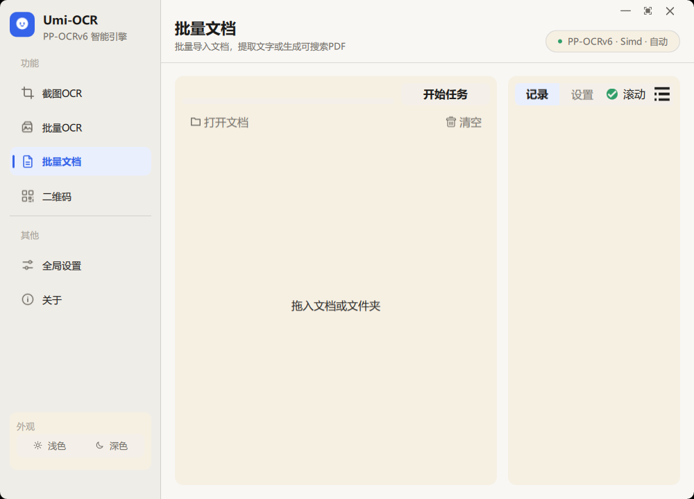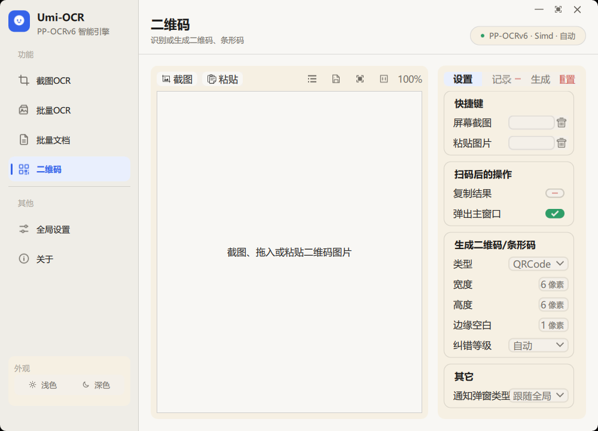
  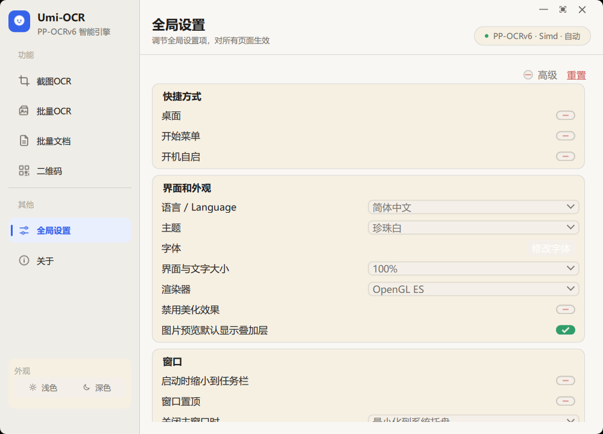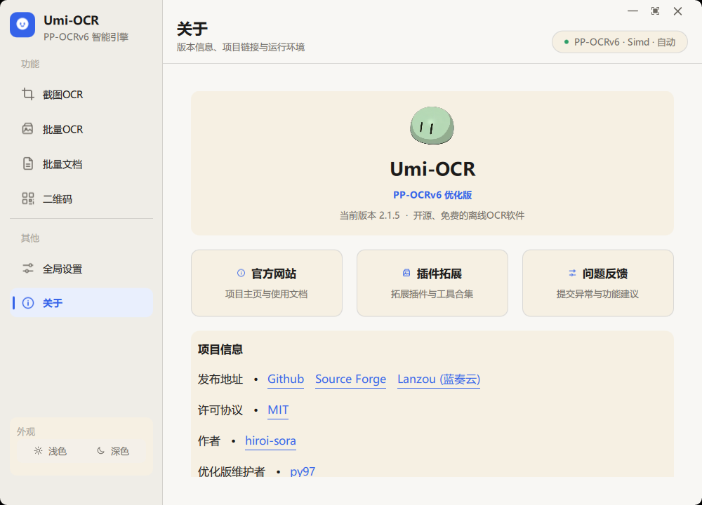
</p>
<p align="center"><sub>左上起：截图 OCR · 批量 OCR · 批量文档 · 二维码 · 全局设置 · 关于（默认 Default Light 暖色主题）</sub></p>

对应的设计稿（Ardot 设计系统，5 个窗口界面）：

<p align="center">
  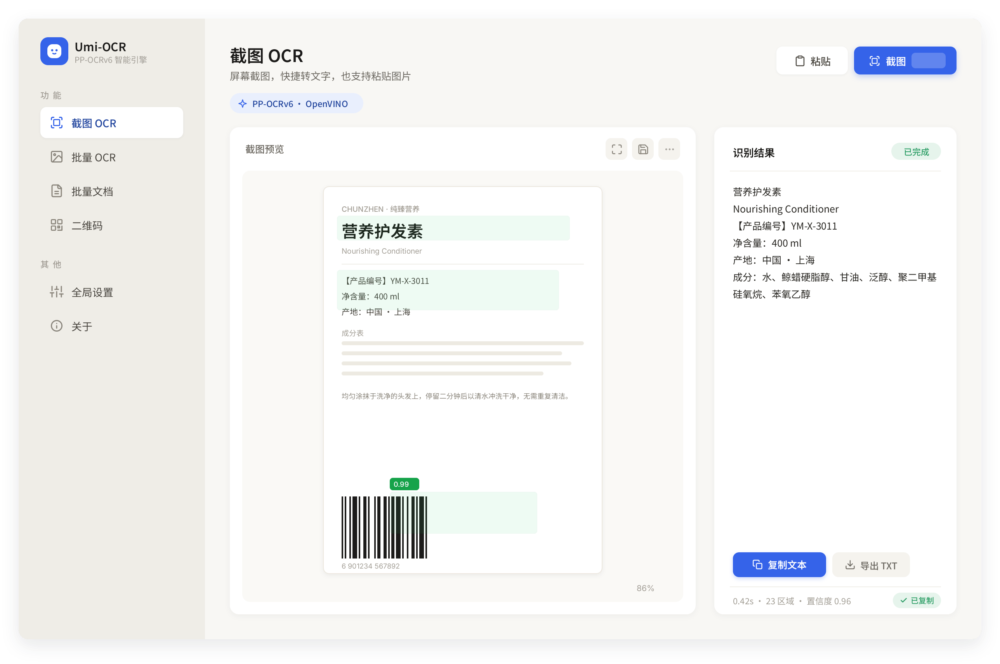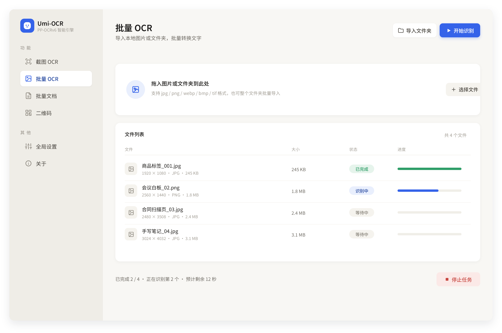
  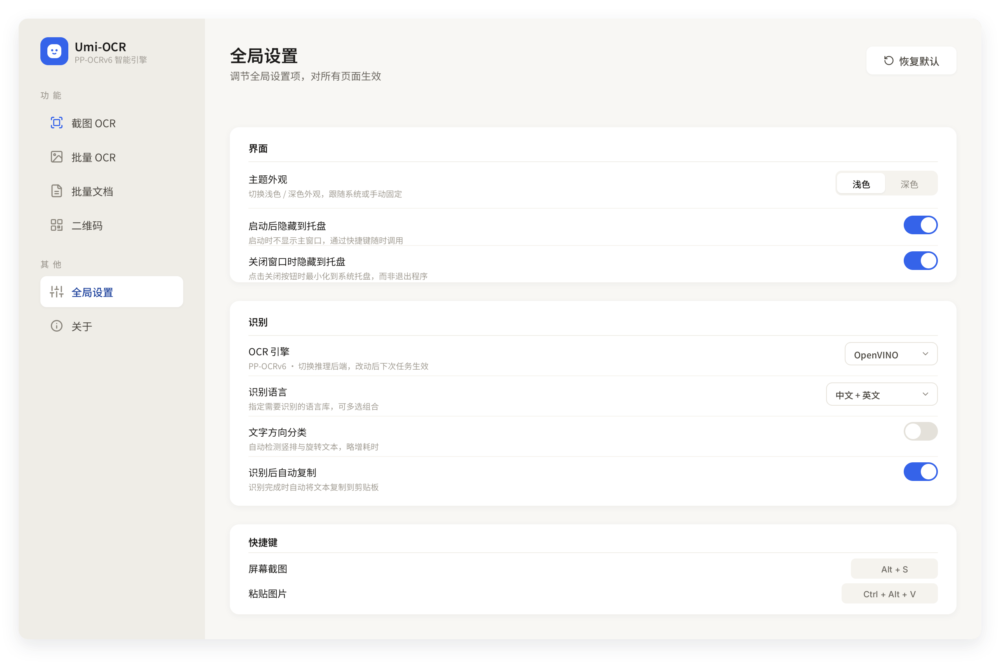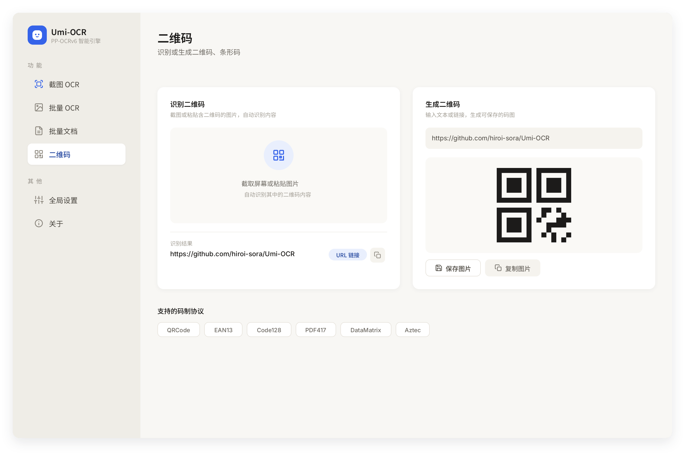
  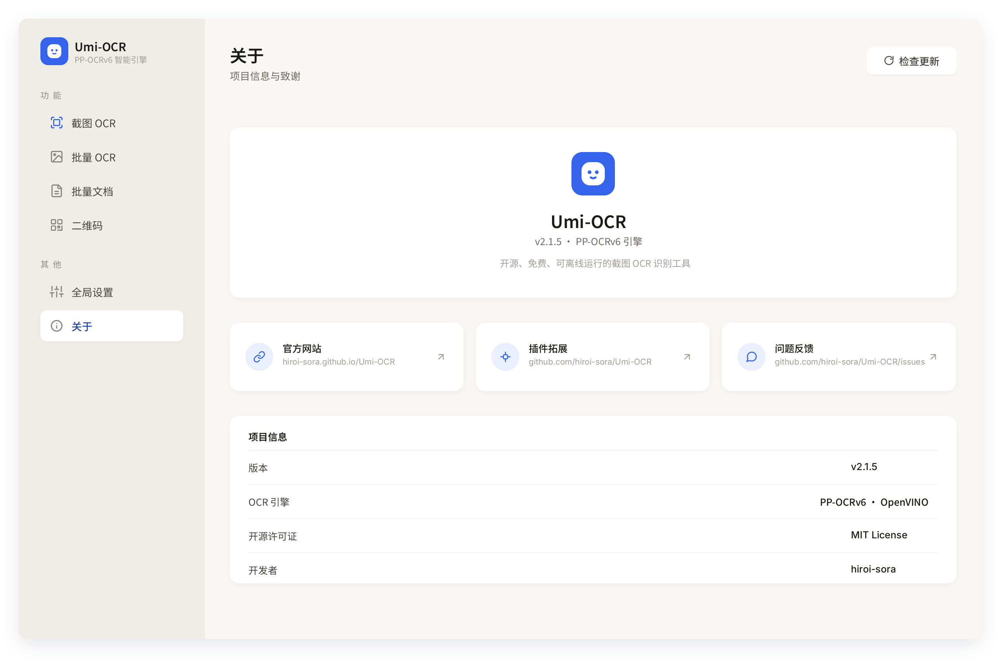
</p>
<p align="center"><sub>界面重设计的原始设计稿：品牌蓝 #3563E9 强调 · 暖中性画布 · 侧边导航取代标签页</sub></p>

---

## 与原版相比的主要改动

| 改动项 | 说明 |
| --- | --- |
| 🆕 SimdPaddleOCR 引擎 | 移除原版全部 OCR 插件，仅保留自研的 `win_x64_SimdPaddleOCR` 插件：Python 侧通过 localhost HTTP 调用独立的 .NET 推理进程（`SimdOcrHost.exe`） |
| 🧹 彻底移除旧引擎 | 删除原 `win_x64_PPOCRv6`（OpenCV/OpenVINO 后端）与 `win7_x64_RapidOCR-json` 插件，消除 MSVCP140 运行时抢占等原生库问题 |
| 🪟 无边框窗口 | `Main.qml` 采用 `FramelessWindowHint`，自带四边/四角拖拽缩放与标题栏拖拽移动 |
| 🎛 窗口控制按钮 | 顶部右侧集成中性的 最小化 / 最大化(还原) / 关闭 按钮（SVG 图标） |
| 🧭 侧边导航 | 以左侧导航栏（`SideNavShell`）取代原标签页布局，重构各功能页 |
| 🎨 暖色主题 | 统一暖黄调：画布 `#F8F7F4`、侧栏 `#EFEDE7`、卡片背景 `#F6F0E3`，消除纯白背景突兀问题 |
| 🔧 链接修复 | 修复关于页链接在浅色主题下白字不可见的问题 |

其余功能（截图 OCR、批量 OCR、文档识别、二维码、命令行 / HTTP 接口、多语言、全局设置等）与原版一致。

---

## 下载与运行

### 方式一：下载发布包（推荐，开箱即用）

前往本仓库 **Releases** 页面，下载最新的 `.7z` 便携包，解压后双击 `Umi-OCR.exe` 即可运行。
该包是完整的可运行程序（含 Python 运行环境、PySide2、.NET 推理进程与模型文件），无需联网、无需安装。

> 若浏览器 / 杀毒软件拦截，请将解压后的整个文件夹加入白名单再运行。

### 方式二：从源码仓库二次开发

本仓库（`git clone` 得到的内容）只包含**源码与文档**，不含运行期二进制。
若你想基于源码修改界面或功能，再自行组装运行包：

```bash
git clone https://github.com/py97/Umi-OCR-PPOCRv6.git
cd Umi-OCR-PPOCRv6
# 源码位于 UmiOCR-data/：py_src/（Python）、qt_res/（QML 界面）、plugins/*/src/（C# 推理进程）
# 运行所需的 runtime/、site-packages/、plugins/*/backend/、models/ 请从对应 Releases 包中提取，
# 或按「二次开发与构建」说明自行准备。
```

> 仅想使用程序的普通用户，直接走「方式一」下载 Release 包即可，无需克隆源码。

### 启动方式（针对已解压的发布包）

- **`Umi-OCR.exe`** —— 主启动器（推荐，双击即用）。
- **`启动Umi-OCR.bat`** —— 备用启动脚本（不弹出控制台窗口）。
- **`启动Umi-OCR(调试).bat`** —— 调试启动，会保留控制台窗口以便查看日志。

---

## 功能特性

- **免费 / 离线**：所有代码开源，完全本地运行，无需网络。
- **高效识别**：内置 SimdPaddleOCR 引擎（PP-OCRv6 tiny：检测 + 方向分类 + 识别），中文识别质量优；默认 CPU 多线程推理，检测到可用 GPU 时自动切换 Vulkan 加速。
- **无原生库烦恼**：推理进程为纯托管 .NET 程序（自带运行时），与 Python 主进程完全隔离，不加载任何 OpenCV / OpenVINO / CUDA 原生 DLL。
- **截图 OCR**：快捷键唤起截图，识别图中文字；支持划选复制、粘贴图片识别。
- **批量 OCR**：一次性导入几百张图片，输出 `txt / jsonl / md / csv(Excel)`；支持忽略区域、任务完成后自动关机/休眠。
- **文档识别**：`pdf / xps / epub / mobi / fb2 / cbz` 扫描件 OCR，可输出**双层可搜索 PDF**；支持忽略区域。
- **二维码**：截图/粘贴/拖入图片读取二维码、条形码（支持 19 种协议、一图多码）；也可输入文本生成二维码。
- **灵活调用**：支持命令行、HTTP 接口等外部调用方式。
- **多语言界面**：支持简中、繁中、英语、日语等。

---

## OCR 引擎说明

- **默认引擎（唯一引擎）：PP-OCRv6（SimdPaddleOCR）** —— PaddleOCR 最新一代模型，内置中文 PP-OCRv6 tiny（检测 + 方向分类 + 识别）。
- **架构**：主程序通过 localhost HTTP 调用 `UmiOCR-data/plugins/win_x64_SimdPaddleOCR/backend/SimdOcrHost.exe`，OCR 推理在独立进程中完成；主程序退出时推理进程自动关闭，异常退出后 10 分钟无任务也会自行退出，不会残留孤儿进程。
- **推理后端**（「全局设置 → PP-OCRv6（SimdPaddleOCR）→ 推理后端」）：
  - **自动**（默认）：检测到可用 GPU 时使用 Vulkan，否则回退 CPU；
  - **CPU**：纯 CPU 多线程推理（兼容性最好，通吃所有 x64 机器）；
  - **Vulkan**：强制使用 Vulkan GPU 加速。
- **源码**：推理进程源码位于 `UmiOCR-data/plugins/win_x64_SimdPaddleOCR/src/`，具备 .NET 10 SDK 即可自行编译（`dotnet publish -c Release`）。

---

## 界面与主题

- 默认主题 **Default Light**（暖黄调）。另有深色 **Default Dark** 等多套主题。
- 切换路径：主界面 → 全局设置 → 界面和外观 → 主题。
- 窗口无系统标题栏：拖动标题栏区域移动窗口，拖动窗口四边/四角缩放；右上角按钮控制 最小化 / 最大化(还原) / 关闭。

---

## 目录结构（Release 便携包）

```
Umi-OCR-PPOCRv6/
├─ Umi-OCR.exe                      主启动器（双击运行）
├─ 启动Umi-OCR.bat / 启动Umi-OCR(调试).bat   备用启动脚本
├─ 说明.txt                         包内快速说明
├─ README.md / LICENSE / LICENSE-SimdPaddleOCR / NOTICE.md   文档与许可
└─ UmiOCR-data/
   ├─ main.py                       程序入口（源码）
   ├─ qt_res/                       QML 界面源码（含本版界面重设计）
   ├─ py_src/                       项目 Python 源码
   ├─ plugins/
   │  └─ win_x64_SimdPaddleOCR/     SimdPaddleOCR 引擎插件（唯一 OCR 引擎）
   │     ├─ backend/                 自包含 .NET 推理进程（SimdOcrHost.exe）
   │     ├─ models/ppocrv6-tiny/     PP-OCRv6 tiny ONNX 模型
   │     └─ src/                     推理进程 C# 源码
   ├─ i18n/                         翻译文件（源码）
   ├─ runtime/                      Python 运行环境（Release 附，仓库不含）
   └─ site-packages/                第三方 Python 依赖 PySide2 等（Release 附，仓库不含）
```

> **Git 仓库仅包含源码与文档**（上方标注「源码」「仓库含」的部分）。
> 运行所需的二进制（`runtime/`、`site-packages/`、`plugins/*/backend/`、`models/`、`Umi-OCR.exe`）
> 随 Releases 的 `.7z` 包分发，**不进入 git 版本库**。

---

## 命令行 / HTTP 接口

- 命令行手册：见上游文档 [Umi-OCR CLI](https://github.com/hiroi-sora/Umi-OCR/blob/main/docs/README_CLI.md)
- HTTP 接口手册：见上游文档 [Umi-OCR HTTP API](https://github.com/hiroi-sora/Umi-OCR/blob/main/docs/http/README.md)

> 本优化版沿用原版的调用接口，未做破坏性改动。

---

## 许可证与致谢

本项目在 **MIT 许可证** 下分发。依据许可要求，以下著作权与许可信息随分发一同保留（详见 `NOTICE.md`）：

- **Umi-OCR**（主体框架、界面与 Python 源码）：Copyright (c) 2023 [hiroi-sora](https://github.com/hiroi-sora)，MIT。
- **SimdPaddleOCR**（OCR 推理引擎）：Copyright (c) 2023-2026 [sdcb](https://github.com/sdcb/SimdPaddleOCR)，Apache-2.0（许可见 `LICENSE-SimdPaddleOCR`）。
- **PaddleOCR 模型**（PP-OCRv6 tiny ONNX 模型）：Apache-2.0，源自 [PaddleOCR](https://github.com/PaddlePaddle/PaddleOCR)。
- **.NET 运行时**：随 `SimdOcrHost.exe` 自包含分发，MIT。

感谢以上所有原作者与贡献者。本优化版仅在上述许可之上叠加界面与引擎整合的修改，不替换任何原有版权声明。

---

## 免责声明

本软件按「原样」提供，不提供任何明示或暗示的担保。使用本软件所产生的任何后果由使用者自行承担。
各第三方组件的许可条款以本目录下对应许可证文件及 `NOTICE.md` 为准。

---

## 二次开发与构建

本仓库为源码与文档仓库，运行期二进制通过 Releases 的 `.7z` 分发。如需从源码运行或二次开发：

- 界面源码位于 `UmiOCR-data/qt_res/qml/`，主题令牌在 `UmiOCR-data/themes.json` 与 `UmiOCR-data/qt_res/qml/Themes/Theme.qml`。
- OCR 推理进程源码位于 `UmiOCR-data/plugins/win_x64_SimdPaddleOCR/src/`，需 [.NET 10 SDK](https://dotnet.microsoft.com/download) 编译：`dotnet publish -c Release -r win-x64 --self-contained`，产物放入 `backend/`。
- 运行环境基于 [PyStand](https://github.com/skywind3000/PyStand) 定制版（见 Release 包的 `UmiOCR-data/runtime/`）；第三方依赖见 Release 包的 `UmiOCR-data/site-packages/`。
- 上游构建说明见 [Umi-OCR 构建文档](https://github.com/hiroi-sora/Umi-OCR#构建项目)。

---

## Star History

<a href="https://www.star-history.com/?repos=py97%2FUmi-OCR-PPOCRv6&type=date&legend=top-left">
<picture>
<source media="(prefers-color-scheme: dark)" srcset="https://api.star-history.com/chart?repos=py97/Umi-OCR-PPOCRv6&type=date&theme=dark&legend=top-left" />
<source media="(prefers-color-scheme: light)" srcset="https://api.star-history.com/chart?repos=py97/Umi-OCR-PPOCRv6&type=date&legend=top-left" />

</picture>
</a>

---

<p align="center">基于 <a href="https://github.com/hiroi-sora/Umi-OCR">Umi-OCR</a> v2.1.5 · MIT 许可 · 仅供学习与非商业使用</p>
